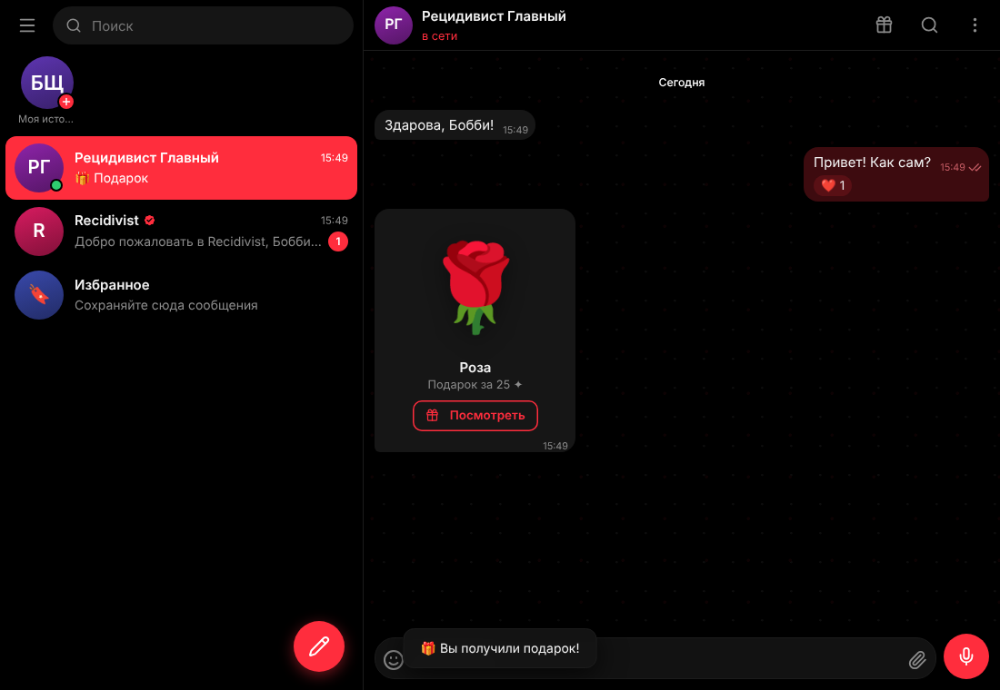
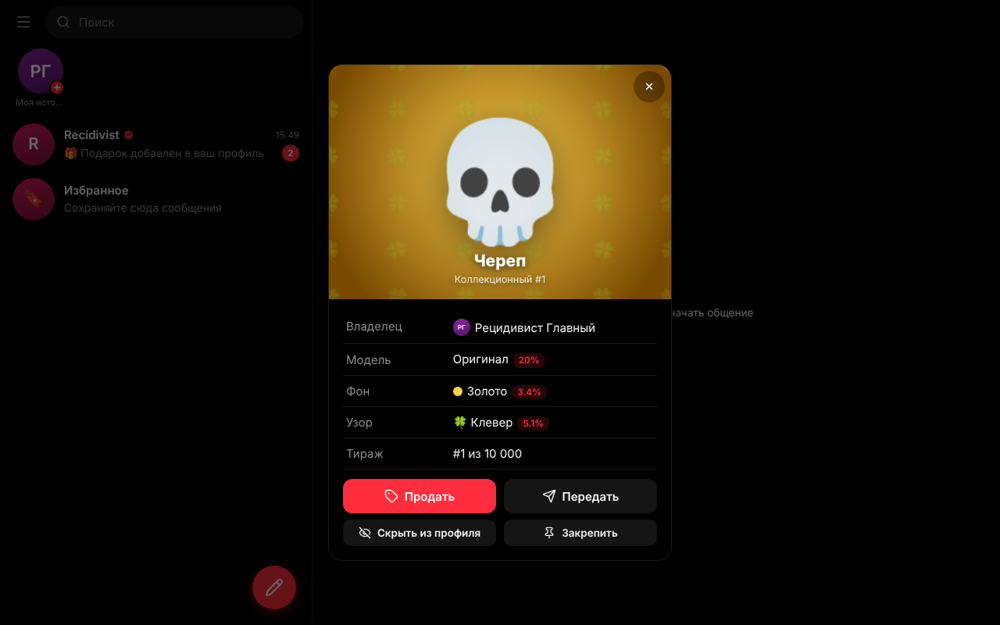
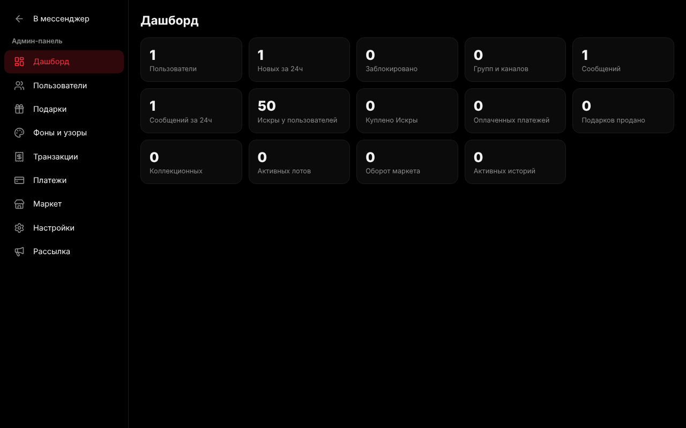

# Recidivist

Мессенджер в духе Telegram со своей валютой (**Искры ✦**), лимитированными и коллекционными подарками, маркетом юзернеймов и подарков, историями, каналами и группами. Вход — по сид-фразе из 12 слов, как в криптокошельке.

Дизайн по умолчанию — **OLED-чёрный с красным**; фон, акцентный цвет, размер текста и скругление сообщений настраиваются.

<p>
  
  
  
  
</p>

## Возможности

**Аккаунт**
- Регистрация: email → код подтверждения → генерация сид-фразы BIP39 (12 слов) → проверка 3 слов → профиль.
- Вход только по сид-фразе. Фраза не покидает устройство: клиент выводит из неё ключ (BIP39 seed → HMAC-SHA256), сервер хранит лишь хеш ключа.
- Профиль: аватар, имя, «о себе», эмодзи-статус, галочка верификации.

**Общение**
- Личные чаты, группы, каналы (публичные `@ссылки` и пригласительные ссылки), «Избранное».
- Текст, фото, видео, файлы, голосовые (запись в браузере), ответы, пересылка, редактирование, удаление, реакции (двойной клик — ❤️), поиск по чату.
- Реалтайм на Socket.IO: новые сообщения, «печатает…», онлайн и «был(а) в сети», прочтение (двойные галочки), счётчики непрочитанных, просмотры постов в каналах.
- Закрепление и выключение звука для чатов, роли в группах (владелец/админ/участник), уведомления браузера.
- Истории на 24 часа: фото, видео, текст на градиенте; список просмотревших, реакции и ответы в личку.
- Глобальный поиск людей и публичных чатов, ссылки вида `/@username` и `/join/<код>`.

**Экономика**
- Искры ✦ — внутренняя валюта (название и символ меняются в админке).
- Пополнение: **TON Connect** (оплата с кошелька, с проверкой через toncenter по комментарию к платежу) и **xRocket Pay** (TON / USDT, вебхук + опрос счёта). В dev-режиме есть кнопка тестовой оплаты.
- Переводы искр между пользователями прямо из профиля.
- **Подарки**: обычные и лимитированные (с тиражом и счётчиком «осталось N»), отправка с сообщением, анонимно или себе; подарок можно конвертировать обратно в искры.
- **Улучшение до коллекционного**: подарок получает номер `#N`, случайную **модель**, **фон** и **узор**, у каждого атрибута своя редкость (показывается в %). Коллекционные подарки можно передавать и продавать.
- **Маркет**: продажа коллекционных подарков и юзернеймов между пользователями: фильтры по коллекциям с минимальной ценой, сортировка, «мои лоты», история сделок, комиссия платформы.
- **Коллекционные юзернеймы**: у одного аккаунта может быть несколько юзернеймов, один из них основной, остальные можно продать.

**Админ-панель** (`/admin`)
- Дашборд со статистикой.
- Пользователи: поиск, выдача и списание искр с причиной, бан, верификация, назначение админов, история операций.
- Подарки: создание и редактирование (цена, тираж, цена улучшения, конвертация), редактор моделей и их редкости, выдача подарка пользователю.
- Фоны и узоры коллекционок: добавление, настройка редкости.
- Транзакции, платежи (ручное зачисление), модерация маркета.
- Настройки: название валюты, комиссия маркета, минимальная цена лота, цена юзернейма, бонус за регистрацию, пакеты пополнения.
- Рассылка всем пользователям от официального аккаунта `@recidivist`.

## Быстрый старт

Нужен Node.js 20+.

```bash
npm run install:all
cp server/.env.example server/.env   # при необходимости отредактируйте

# разработка — два терминала:
npm run dev:server    # API + сокеты на :4000
npm run dev:web       # Vite на :5173 (проксирует /api и /socket.io)
```

Откройте http://localhost:5173 и зарегистрируйтесь. Без SMTP код подтверждения **печатается в консоли сервера**. В dev-режиме первый зарегистрированный пользователь становится админом, если `ADMIN_EMAILS` пуст.

Продакшен (сервер раздаёт собранный клиент):

```bash
npm run build
NODE_ENV=production npm start   # http://localhost:4000
```

Назначить админа вручную: `npm --prefix server run make-admin -- you@example.com`.

## Настройка платежей

| Способ | Переменные | Примечание |
|---|---|---|
| TON Connect | `TON_WALLET_ADDRESS`, опц. `TONCENTER_API_KEY` | Клиент отправляет TON с комментарием `RCD-…`, сервер находит транзакцию через toncenter. В `web/public/tonconnect-manifest.json` укажите свой домен: манифест должен быть доступен публично по HTTPS. |
| xRocket Pay | `XROCKET_API_KEY` | Счёт создаётся через `POST /tg-invoices`. В настройках приложения xRocket укажите вебхук `${PUBLIC_URL}/api/webhooks/xrocket`. Даже без вебхука оплата подтвердится опросом счёта. |
| Тест | `ALLOW_TEST_PAYMENTS` | Включено по умолчанию, если не `NODE_ENV=production`. |

> Перед запуском с реальными деньгами сверьте с актуальной документацией xRocket Pay формат подписи вебхука (`rocket-pay-signature`) и поля ответа. Интеграция написана по их публичному API, но с живым ключом не проверялась.

## Архитектура

```
server/            Node.js · Express 5 · Socket.IO · SQLite (better-sqlite3)
  src/db.js        схема БД и стартовые данные (подарки, фоны, узоры, модели)
  src/services.js  сериализация, леджер баланса, уведомления, общая логика
  src/routes/      auth · users · chats · stories · gifts · market · wallet · admin
web/               React 18 · Vite · Zustand · socket.io-client · TonConnect UI
  src/pages/       Auth · Main · Admin
  src/components/  Sidebar · ChatView · Profile · Gifts · Market · Wallet · Stories · Settings
```

- Все денежные операции проходят через `changeBalance()` внутри транзакции SQLite и пишутся в журнал `transactions` с балансом после операции.
- Покупка на маркете атомарна: списание у покупателя, зачисление продавцу за вычетом комиссии и передача владения идут одной транзакцией. Есть защита от смены цены (`expectedPrice`).
- Файлы складываются в `server/data/uploads`, БД — в `server/data/recidivist.db`.

## Мобильные и десктопные версии (план)

Клиент — обычный React SPA, поэтому нативные сборки делаются из той же кодовой базы:

- **Android / iOS** — [Capacitor](https://capacitorjs.com): `npm i @capacitor/core @capacitor/cli`, `npx cap add android` / `ios`, и `VITE_API_URL=https://ваш-сервер` при сборке. `.ipa` собирается в Xcode (Archive → Export), для установки вне App Store подписывается своим сертификатом (AltStore, Sideloadly, TrollStore и т. п.). Пуш-уведомления — через `@capacitor/push-notifications` + FCM/APNs.
- **Windows** — Electron или Tauri: оборачивают тот же `web/dist`, указывают `VITE_API_URL`.
- Уже есть PWA-манифест: веб-версию можно «установить» на телефон из браузера.

## Дальнейшие шаги

- Сквозное шифрование для секретных чатов (X25519 из той же сид-фразы).
- Звонки (WebRTC), стикеры, GIF, опросы, отложенные сообщения.
- Перенос на PostgreSQL и S3 для масштабирования, Redis-адаптер Socket.IO для нескольких инстансов.
- Ограничение частоты запросов (rate limiting) и антиспам, модерация жалоб.
