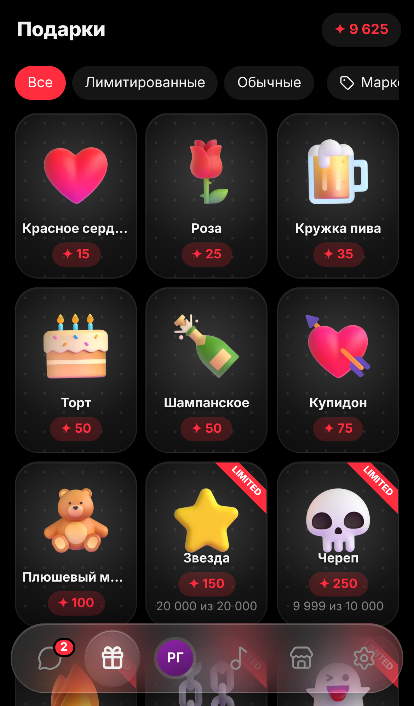

# Recidivist

Мессенджер в духе Telegram со своей валютой (**Искры ✦**), лимитированными и коллекционными подарками, маркетом юзернеймов и подарков, историями, каналами и группами. Вход — по сид-фразе из 12 слов, как в криптокошельке.

Дизайн по умолчанию — **OLED-чёрный с красным**; фон, акцентный цвет, размер текста и скругление сообщений настраиваются.

<p>
  
  
  
  
</p>

## Возможности

**Аккаунт**
- Регистрация: email → код подтверждения → генерация сид-фразы BIP39 (12 слов) → проверка 3 слов → профиль.
- Вход только по сид-фразе. Фраза не покидает устройство: клиент выводит из неё ключ (BIP39 seed → HMAC-SHA256), сервер хранит лишь хеш ключа.
- Профиль: аватар, имя, «о себе», эмодзи-статус, галочка верификации.

**Общение**
- Личные чаты, группы, каналы (публичные `@ссылки` и пригласительные ссылки), «Избранное».
- Текст, фото, видео, файлы, голосовые (запись в браузере), ответы, пересылка, редактирование, удаление, реакции (двойной клик — ❤️), поиск по чату.
- Реалтайм на Socket.IO: новые сообщения, «печатает…», онлайн и «был(а) в сети», прочтение (двойные галочки), счётчики непрочитанных, просмотры постов в каналах.
- Закрепление и выключение звука для чатов, роли в группах (владелец/админ/участник), уведомления браузера.
- Истории на 24 часа: фото, видео, текст на градиенте; список просмотревших, реакции и ответы в личку.
- Глобальный поиск людей и публичных чатов, ссылки вида `/@username` и `/join/<код>`.

**Интерфейс**
- Плавающее стеклянное нижнее меню: Чаты · Подарки · Профиль · Музыка · Маркет · Настройки.
- Анимации переходов, сообщений, карточек и кнопок; зум и «резиновая» прокрутка заблокированы, интерфейс всегда ровный (лучше всего — «На экран Домой» как приложение).

**Музыка**
- Своя медиатека: загрузка mp3/m4a/flac/wav, название и исполнитель из имени файла «Исполнитель - Трек».
- Плеер: очередь, перемешивание, повтор, таймер сна, мини-плеер над меню, управление с экрана блокировки (Media Session).
- Треки можно отправлять в чат и сохранять себе одной кнопкой.
- Поиск по открытым источникам: Internet Archive и Jamendo (полные треки под свободными лицензиями), Deezer (30-секундные превью). Распознавание песни рядом с микрофона через AudD (`AUDD_API_TOKEN`).

**Анонимные номера**
- Бот @numbers внутри приложения выдаёт номер и привязывает его к профилю: `+888` — для всех (любой свободный номер), `+999` — тестировщики (флаг в админке), `+000` — разработчик (админы).

**Экономика**
- Искры ✦ — внутренняя валюта (название и символ меняются в админке).
- Пополнение: **TON Connect** (оплата с кошелька, с проверкой через toncenter по комментарию к платежу) и **xRocket Pay** (TON / USDT, вебхук + опрос счёта). В dev-режиме есть кнопка тестовой оплаты.
- Переводы искр между пользователями прямо из профиля.
- **Подарки**: обычные и лимитированные (с тиражом и счётчиком «осталось N»), отправка с сообщением, анонимно или себе; подарок можно конвертировать обратно в искры.
- **3D-подарки**: объёмные (многие — анимированные) модели из Microsoft Fluent Emoji (MIT), лежат в `web/public/emoji3d` и `web/public/emoji-anim`; новый подарок из админки автоматически получает 3D-модель по эмодзи.
- **Улучшение до коллекционного**: подарок получает номер `#N`, случайную **модель**, **фон** и **узор**, у каждого атрибута своя редкость (показывается в %). Коллекционные подарки можно передавать, продавать и «надевать» — они показываются рядом с именем.
- **Маркет**: продажа коллекционных подарков и юзернеймов между пользователями: фильтры по коллекциям с минимальной ценой, сортировка, «мои лоты», история сделок, комиссия платформы.
- **Коллекционные юзернеймы**: у одного аккаунта может быть несколько юзернеймов, один из них основной, остальные можно продать.

**Админ-панель** (`/admin`)
- Дашборд со статистикой.
- Пользователи: поиск, выдача и списание искр с причиной, бан, верификация, назначение админов, история операций.
- Подарки: создание и редактирование (цена, тираж, цена улучшения, конвертация), редактор моделей и их редкости, выдача подарка пользователю.
- Фоны и узоры коллекционок: добавление, настройка редкости.
- Транзакции, платежи (ручное зачисление), модерация маркета.
- Настройки: название валюты, комиссия маркета, минимальная цена лота, цена юзернейма, бонус за регистрацию, пакеты пополнения.
- Рассылка всем пользователям от официального аккаунта `@recidivist`.

## Быстрый старт

Нужен Node.js 20+.

```bash
npm run install:all
cp server/.env.example server/.env   # при необходимости отредактируйте

# разработка — два терминала:
npm run dev:server    # API + сокеты на :4000
npm run dev:web       # Vite на :5173 (проксирует /api и /socket.io)
```

Откройте http://localhost:5173 и зарегистрируйтесь. Без SMTP код подтверждения **печатается в консоли сервера**. В dev-режиме первый зарегистрированный пользователь становится админом, если `ADMIN_EMAILS` пуст.

Продакшен (сервер раздаёт собранный клиент):

```bash
npm run build
NODE_ENV=production npm start   # http://localhost:4000
```

Назначить админа вручную: `npm --prefix server run make-admin -- you@example.com`.

## Настройка платежей

| Способ | Переменные | Примечание |
|---|---|---|
| TON Connect | `TON_WALLET_ADDRESS`, опц. `TONCENTER_API_KEY` | Клиент отправляет TON с комментарием `RCD-…`, сервер находит транзакцию через toncenter. Манифест `/tonconnect-manifest.json` сервер отдаёт сам под домен, на котором открыт сайт (нужен публичный HTTPS). |
| xRocket Pay | `XROCKET_API_KEY` | Счёт создаётся через `POST /tg-invoices`. В настройках приложения xRocket укажите вебхук `${PUBLIC_URL}/api/webhooks/xrocket`. Даже без вебхука оплата подтвердится опросом счёта. |
| Тест | `ALLOW_TEST_PAYMENTS` | Включено по умолчанию, если не `NODE_ENV=production`. |

> Перед запуском с реальными деньгами сверьте с актуальной документацией xRocket Pay формат подписи вебхука (`rocket-pay-signature`) и поля ответа. Интеграция написана по их публичному API, но с живым ключом не проверялась.

## Архитектура

```
server/            Node.js · Express 5 · Socket.IO · SQLite (better-sqlite3)
  src/db.js        схема БД и стартовые данные (подарки, фоны, узоры, модели)
  src/services.js  сериализация, леджер баланса, уведомления, общая логика
  src/routes/      auth · users · chats · stories · gifts · market · wallet · admin
web/               React 18 · Vite · Zustand · socket.io-client · TonConnect UI
  android/ ios/    нативные проекты Capacitor
desktop/           Electron-клиент для ПК
  src/pages/       Auth · Main · Admin
  src/components/  Sidebar · ChatView · Profile · Gifts · Market · Wallet · Stories · Settings
```

- Все денежные операции проходят через `changeBalance()` внутри транзакции SQLite и пишутся в журнал `transactions` с балансом после операции.
- Покупка на маркете атомарна: списание у покупателя, зачисление продавцу за вычетом комиссии и передача владения идут одной транзакцией. Есть защита от смены цены (`expectedPrice`).
- Файлы складываются в `server/data/uploads`, БД — в `server/data/recidivist.db`.

## Клиенты (Android / iOS / ПК)

Нативные клиенты — это тот же веб-клиент из `web/`, собранный в режиме приложения (`npm run build:app` = `vite build --mode app`, переменные в `web/.env.app`). Приложение ходит на сервер `https://recidivist.lol` (API, Socket.IO, `/uploads`), а интерфейс, звуки, иконки и 3D-подарки лежат внутри самого приложения.

```
web/capacitor.config.json   Capacitor: appId lol.recidivist.app, appName Recidivist, webDir dist
web/android/                Android-проект (Capacitor 7, Gradle)
web/ios/                    iOS-проект (Capacitor 7, Xcode + CocoaPods)
web/assets/                 исходники иконки и сплэша (генерация: npx @capacitor/assets generate)
desktop/                    Electron: Windows (установщик + portable), macOS (dmg), Linux (AppImage)
.github/workflows/clients.yml   сборка всех клиентов в GitHub Actions
```

### Как получить APK / IPA / EXE (GitHub Actions)

1. На GitHub откройте репозиторий → вкладка **Actions** → слева workflow **Clients** → кнопка **Run workflow** (ветка — нужная, поле «Server URL» можно оставить `https://recidivist.lol`) → **Run workflow**.
2. Дождитесь, пока задачи станут зелёными (Android ~10 мин, iOS ~15 мин, ПК ~10 мин; задачи независимы — если одна упала, остальные всё равно соберутся).
3. Откройте завершённый запуск и внизу, в блоке **Artifacts**, скачайте:
   - `Recidivist-android` — `Recidivist-debug.apk` (устанавливается сразу) и `Recidivist-release-unsigned.apk` (без подписи, для своей подписи);
   - `Recidivist-ios` — `Recidivist-unsigned.ipa`;
   - `Recidivist-desktop-Windows` — `Recidivist-Setup-…-x64.exe` (установщик) и `Recidivist-Portable-…-x64.exe`;
   - `Recidivist-desktop-macOS` — `.dmg` (universal: Intel + Apple Silicon);
   - `Recidivist-desktop-Linux` — `.AppImage`.

   Артефакты скачиваются zip-архивом — распакуйте его. Хранятся 90 дней.
4. Если запушить тег вида `v1.0.0` (`git tag v1.0.0 && git push origin v1.0.0`), workflow запустится сам и выложит все файлы в **Releases**.

### Установка

- **Android**: скопируйте `Recidivist-debug.apk` на телефон, откройте его и разрешите «Установку из неизвестных источников» для файлового менеджера/браузера. При первом голосовом сообщении приложение спросит доступ к микрофону.
- **iOS (неподписанный IPA)** — нужно подписать при установке:
  - **AltStore / SideStore**: установите AltStore (AltServer на ПК/Mac), на iPhone откройте AltStore → **My Apps** → **+** → выберите `Recidivist-unsigned.ipa`. Бесплатный Apple ID — приложение нужно обновлять (Refresh) раз в 7 дней.
  - **Sideloadly** (Windows/macOS): подключите iPhone кабелем, перетащите IPA в окно Sideloadly, введите Apple ID → **Start**. Затем на iPhone: Настройки → Основные → VPN и управление устройством → доверять разработчику. На iOS 16+ включите «Режим разработчика» (Настройки → Конфиденциальность и безопасность).
  - **TrollStore** (если поддерживается вашей версией iOS): откройте IPA через «Поделиться» → TrollStore → Install. Подпись не истекает.
- **Windows**: `Recidivist-Setup-…-x64.exe` — обычный установщик (ярлык на рабочем столе и в «Пуске»); `Recidivist-Portable-…-x64.exe` — запускается без установки. Файлы не подписаны, поэтому SmartScreen покажет предупреждение: **Подробнее → Выполнить в любом случае**.
- **macOS**: откройте `.dmg`, перетащите Recidivist в «Программы». Приложение не подписано: первый запуск — правый клик → **Открыть** (или `xattr -cr /Applications/Recidivist.app`).
- **Linux**: `chmod +x Recidivist-*.AppImage && ./Recidivist-*.AppImage`.

### Другой адрес сервера (VITE_API_URL)

- В GitHub Actions: при **Run workflow** укажите свой адрес в поле «Server URL» — он подставится в `VITE_API_URL` и `VITE_TONCONNECT_MANIFEST`.
- Насовсем: поменяйте адрес в `web/.env.app`.
- Разово при локальной сборке переменные окружения важнее файла: `VITE_API_URL=https://my.server VITE_TONCONNECT_MANIFEST=https://my.server/tonconnect-manifest.json npm --prefix web run build:app`.

На сервере ничего настраивать не нужно: CORS уже открыт (`cors()` и Socket.IO с `origin: '*'`), авторизация идёт по токену в заголовке, без кук. Обычная веб-сборка (`npm run build`) работает как раньше — с относительными адресами.

### Локальная сборка

- **Android** (нужны JDK 21 и Android SDK): `cd web && npm ci && npm run cap:android && cd android && ./gradlew assembleDebug` → `web/android/app/build/outputs/apk/debug/app-debug.apk`. Или `npx cap open android` и сборка в Android Studio.
- **iOS** (только macOS + Xcode): `cd web && npm ci && npm run cap:ios && npx cap open ios`.
- **ПК**: `cd desktop && npm ci && npm run dist` (под текущую ОС) или `npm run dist:win` / `dist:mac` / `dist:linux`; результат в `desktop/dist/`. `npm start` — запуск без упаковки. Windows-установщик на Linux собирается только с установленным Wine (`wine64` + `wine32`), архив `--win zip` — без него.

В приложении Electron интерфейс отдаётся по собственному протоколу `app://recidivist/`, внешние ссылки открываются в системном браузере, второй запуск просто разворачивает уже открытое окно, F12 — DevTools.

## Дальнейшие шаги

- Сквозное шифрование для секретных чатов (X25519 из той же сид-фразы).
- Звонки (WebRTC), стикеры, GIF, опросы, отложенные сообщения.
- Перенос на PostgreSQL и S3 для масштабирования, Redis-адаптер Socket.IO для нескольких инстансов.
- Ограничение частоты запросов (rate limiting) и антиспам, модерация жалоб.

## Лицензии графики

- Анимации обычных подарков (`web/public/gifts/regular`) — [Noto Animated Emoji](https://googlefonts.github.io/noto-emoji-animation/), Google, CC BY 4.0.
- 3D-эмодзи (`web/public/emoji3d`) — Fluent Emoji, Microsoft, MIT.

## Нативное приложение (React Native) — `mobile/`

Полноценный нативный клиент на **Expo + React Native** (не веб-страница в оболочке):

| Слой | Что используется |
|---|---|
| UI | нативные экраны React Native, `expo-router` (нативный стек iOS: переходы и свайп назад), Reanimated 4 (анимации на UI-потоке), `expo-blur` (жидкое стекло), `expo-image` (кэш картинок) |
| Локальное хранилище | **SQLite** (`expo-sqlite`): чаты, сообщения, кэш экранов; ключи и токен — в Keychain / Keystore (`expo-secure-store`) |
| Сеть | REST (`/api`) + socket.io (WebSocket, при прокси — long-polling) — модули `src/lib/api.ts`, `src/lib/socket.ts` |
| Прокси | нативный модуль `modules/recidivist-proxy`: HTTP / SOCKS5 для всего трафика (iOS — NSURLSession, Android — OkHttp) |
| Шифрование | сквозное (E2E) для личных чатов: X25519 из сид-фразы + XSalsa20-Poly1305, сервер видит только шифротекст (`src/lib/e2e.ts`) |
| Уведомления | `expo-notifications` (уведомления ОС, открытие чата по нажатию) |
| Производительность | режим производительности: без размытия, частиц и бесконечных анимаций |

Сборка: GitHub → **Actions → Mobile (React Native)** — артефакты `Recidivist-native-ios` (неподписанный IPA) и `Recidivist-native-android` (APK).
Локально: `cd mobile && npm ci && npx expo prebuild && npx expo run:ios` (нужен Xcode) или `run:android`.
